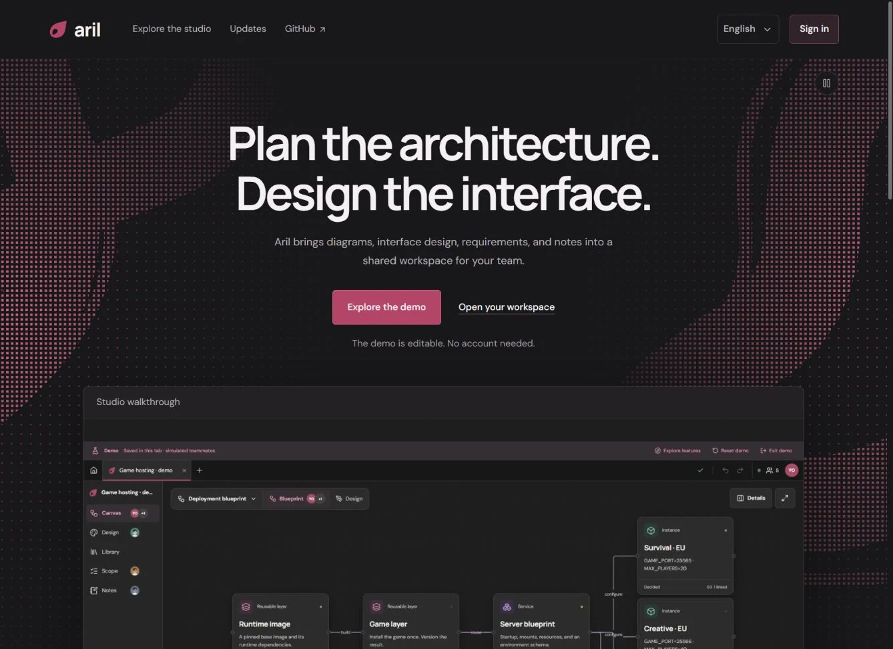
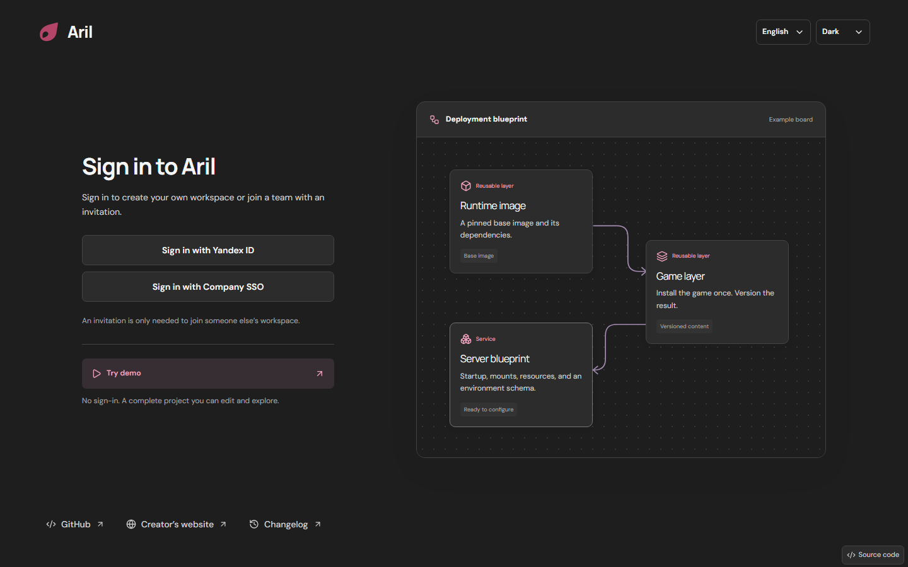
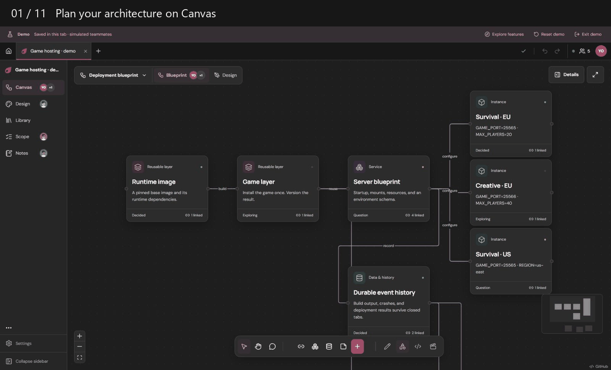
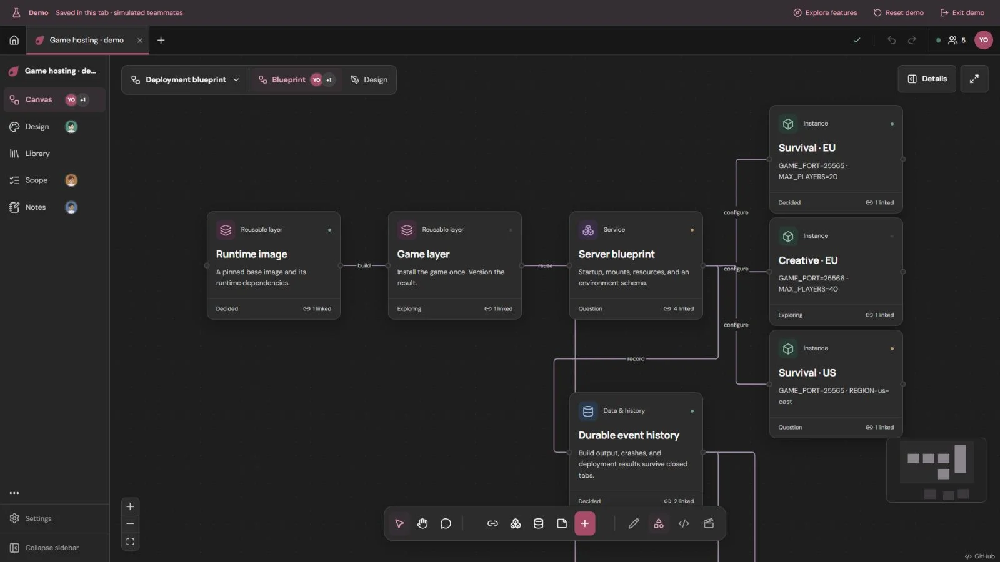
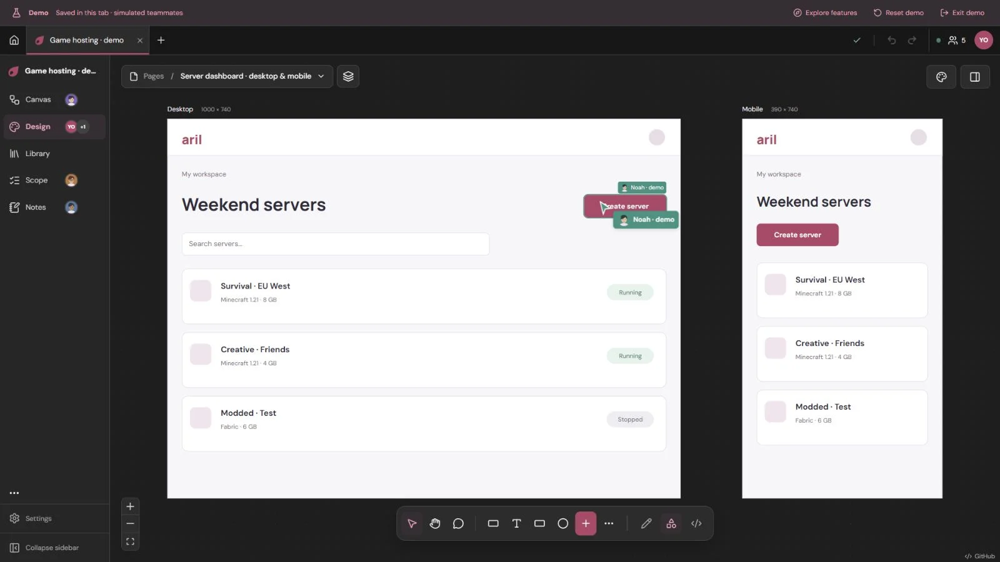
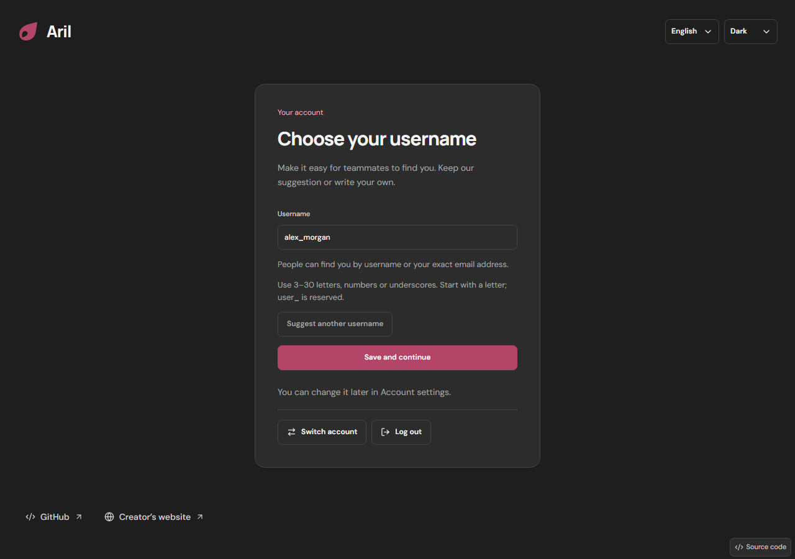
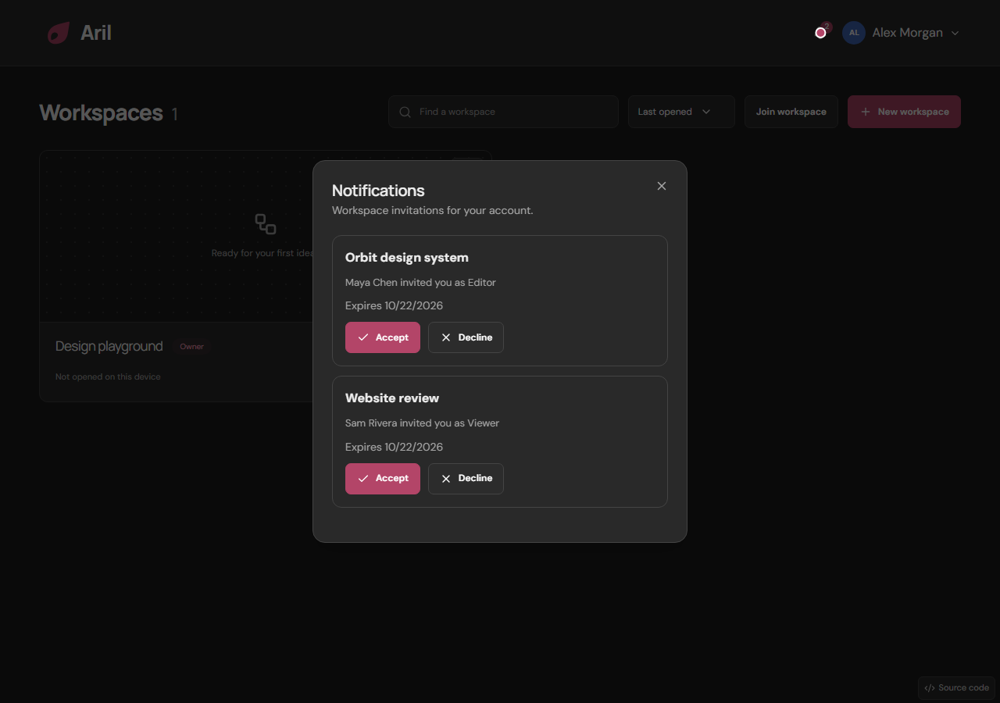
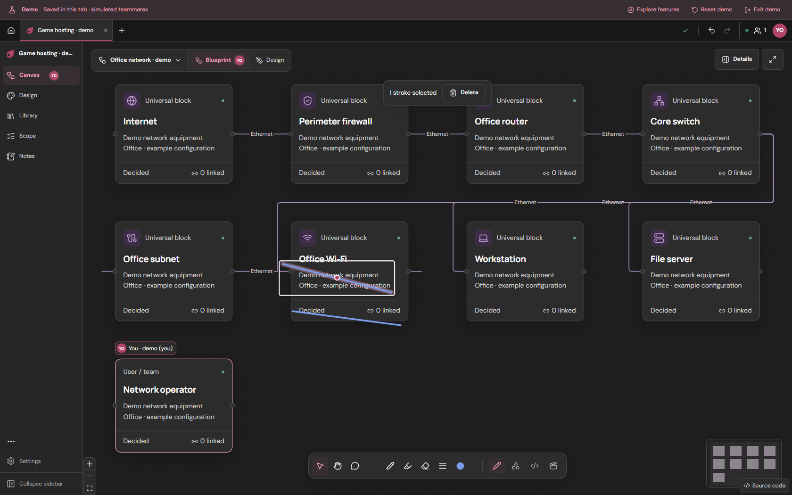
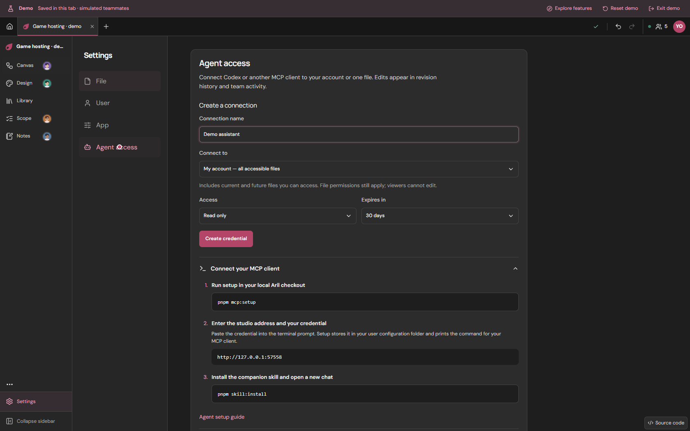
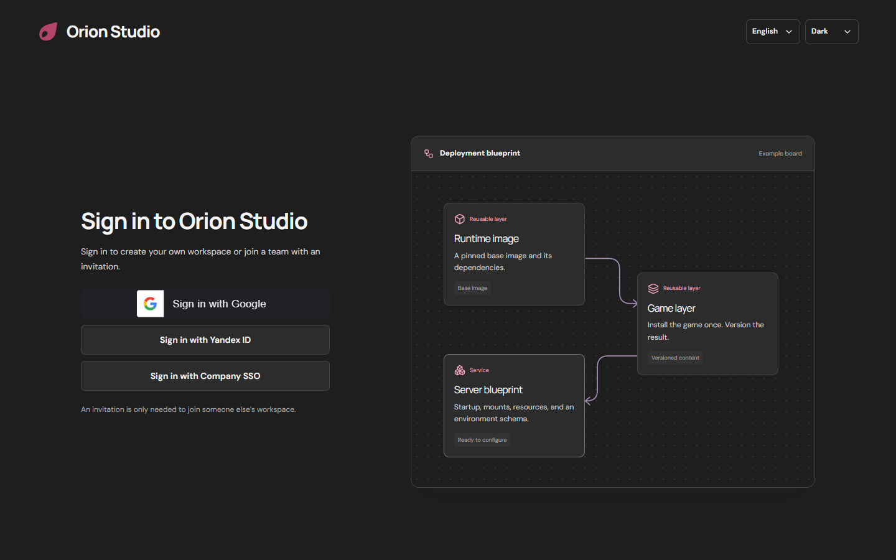

# Aril Planning Studio

A collaborative workspace for architecture diagrams, interface design, requirements, and notes. Built with React, TypeScript, and Express, with SQLite for single-process hosting and Postgres for shared deployments.

[Try the account-free demo](https://www.aril.studio/?demo=1) · [Open Aril](https://www.aril.studio/app) · [Engineering case study](docs/engineering-case-study.md) · [Changelog](https://www.aril.studio/changelog)

[](https://github.com/gilvex/aril/actions/workflows/ci.yml)



The public home introduces the studio, with a playable tour and direct access to the editable demo. Sign in at `/app` to create your own workspace without a code, or use an invitation link to join an existing team. Self-hosted installations go straight to the studio, without the product landing page.



<details>
<summary>Watch the new entry flow (continuous fixture recording)</summary>


</details>



The recording uses editable demo fixtures and simulated teammates. Aril is a planning studio; it does not execute deployments. [Watch with playback controls](https://www.aril.studio/changelog#2026-10-11-changelog).

| Architecture and collaboration                                              | Interface design                                                        |
| --------------------------------------------------------------------------- | ----------------------------------------------------------------------- |
|  |  |

### Invite your team

Open **Notifications** to accept or decline invitations. Workspace owners can invite by email or username in **Settings → File** and choose Editor or Viewer. **Join workspace** opens an invite-link dialog. After your first sign-in, keep the suggested username or write your own. Change it later in **Your account → Account settings**, or **Settings → User → Account** inside a workspace.





<details>
<summary>Watch invitations and username editing (continuous fixture recording)</summary>


</details>

Email delivery is optional and requires a verified Resend sender. [Set up invitation emails](docs/collaboration.md#optional-resend-setup).

### Canvas editing in 0.1.2

Add a **Universal block** from the toolbar and choose its icon visually. Connect nodes through their handles. Click a freehand stroke to select it, use Shift/Ctrl to add strokes, and press Delete. Undo with Ctrl+Z and redo with Ctrl+Shift+Z or Ctrl+Y, including when using a Russian keyboard layout.



<details>
<summary>Watch drawing selection, history and agent setup</summary>


</details>

[Watch with playback controls](https://www.aril.studio/changelog#2026-10-21-canvas-editing). The recording uses generated demo content and contains no real credentials.



## What it does

- **Canvas and Design:** connected architecture and network diagrams, universal blocks with selectable device/network icons, editable interface layers, nested frames, and dockable inspectors.
- **Library:** reusable components and variables with dependency/usage inspection.
- **Scope and Notes:** requirements, decisions, Markdown documents, and saved comments. Notes support concurrent text editing with Yjs.
- **Collaboration:** live cursors, selections, following, and previews; persistent edits use revision checks and recoverable conflict handling.
- **Access and recovery:** owner/editor/viewer permissions, expiring guest links, scoped agent credentials, personal undo, JSON export, and bounded saved revision history.

See the [studio guide](docs/studio-guide.md) for controls and recovery behavior.

## Engineering decisions

| Problem                                                 | Approach                                                                                      | Evidence                                                                                                                 |
| ------------------------------------------------------- | --------------------------------------------------------------------------------------------- | ------------------------------------------------------------------------------------------------------------------------ |
| Concurrent edits must not silently overwrite work       | Revision-checked operations, field preconditions, atomic saves, and preserved recovery drafts | [Collaboration tests](apps/studio/server/collaboration.test.ts), [freshness tests](apps/studio/server/freshness.test.ts) |
| Multiple API instances share one document               | Postgres row locking, atomic history/receipts, and revision conflict handling                 | [Two-instance integration test](apps/studio/server/postgres.test.ts)                                                     |
| Cursor traffic should not become durable writes         | Transient presence, separated from authoritative document saves                               | [Architecture](docs/architecture.md), [hosting](docs/accounts-and-deployment.md)                                         |
| Browser and automation edits need the same access rules | Account or file-scoped agent credentials and shared validation/save paths                           | [Agent integration](docs/agent-integration.md), [access tests](apps/studio/server/workspaceAccess.test.ts)               |

[Case study: preserving edits across collaborators and storage backends](docs/engineering-case-study.md) explains the trade-offs, verification, and remaining limits. [Operations](docs/operations.md) covers health checks, backups, restore drills, and rollback.

## Run locally

Requires Node.js 24+ and the pnpm version pinned in `package.json`.

```sh
pnpm install --frozen-lockfile
pnpm dev
```

Open http://127.0.0.1:5173; the API runs on port 4317. A fresh checkout without cloud configuration uses SQLite. See [hosting and accounts](docs/accounts-and-deployment.md) for Google, Yandex ID, corporate OIDC sign-in and Postgres configuration.

```sh
pnpm build
pnpm start
```

The built application is served at http://127.0.0.1:4317. Run commands from the repository root.



## Docker Compose

Copy `.env.example` to `.env`, set the public `ARIL_ORIGIN` and the desired sign-in providers, then run:

```sh
docker compose up --build -d
```

Open the studio, sign in with a configured provider and choose **New workspace**; no invitation is needed to create your own. With `ARIL_STORAGE=sqlite` (the default), containers use a persistent `studio-data` SQLite volume; your local SQLite file is not imported. Set `ARIL_STORAGE=postgres` in `.env` to use your configured Postgres backend. The service listens on `127.0.0.1:4317`; put an HTTPS reverse proxy in front for remote access and preserve streaming responses. Root `.env` and local data are excluded from the image. Rebuilds preserve the volume; `docker compose down -v` deletes it. See [hosting and SSO setup](docs/accounts-and-deployment.md#sign-in-providers).

Self-hosted installations open the studio sign-in directly by default. The public product site is enabled automatically only when the configured `ARIL_ORIGIN` is `https://aril.studio` or `https://www.aril.studio`; set `ARIL_PRODUCT_SITE_ENABLED=true` to preview it elsewhere, or `false` to disable it. The public home lives at `/`, sign-in and the workspace list at `/app`, and editors at `/w/...`. Source-code links remain available in both modes. Set `ARIL_PRODUCT_NAME` and `ARIL_PRODUCT_LOGO_URL` in the same `.env` to customize its branding. Restart the server to apply; no frontend rebuild is needed. [Company mode](docs/accounts-and-deployment.md#company-sign-in-mode).

## Verify

```sh
pnpm lint
pnpm test
pnpm build
pnpm benchmark:collaboration
pnpm verify:recovery
```

CI runs lint, fixture-based tests, and all package builds on Node 24. A separate job runs the two-instance Postgres integration test against a disposable PostgreSQL service. The local default test run skips that test unless `POSTGRES_TEST_URL` is provided. See [verification](docs/verification.md) for commands and the distinction between automated checks and historical manual observations.

## Repository map

- `apps/studio` — React editor and HTTP API.
- `packages/domain` — schemas and collaboration operations.
- `packages/mcp` — stdio MCP bridge.
- `packages/studio-skill` — companion integration skill.
- `docs` — architecture, operation, and contributor documentation.

[Contributing](CONTRIBUTING.md) · [Architecture](docs/architecture.md) · [Code conventions](docs/code-rules.md) · [Monorepo](docs/monorepo.md)

## Scope and limitations

Aril is the planning deliverable for a future deployment platform. Container execution, infrastructure reconciliation, SAML SSO, and resource-level deployment permissions remain future work. The installable app provides an offline reconnect screen, not offline workspace editing. History is bounded and does not replace database backups. Performance experiments use local fixtures, not production traffic or an availability guarantee.

Packages now use `@aril/*`, the MCP connection is `aril`, and the companion skill is `aril-studio`. One account credential can access your files without reconnecting; file-only credentials remain available. New configuration uses `ARIL_*`; legacy environment aliases and saved MCP configuration remain readable. Existing database schemas, browser storage keys, and user documents are preserved. See the [agent setup and upgrade guide](docs/agent-integration.md).

An open-source license has not yet been selected. Installed design skills and their attribution are documented in [skills and provenance](docs/skills.md).
